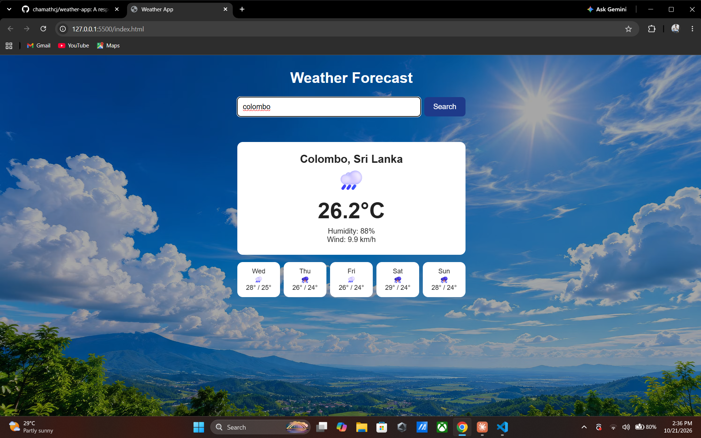

# Weather App

A responsive web app that shows the current weather and a 5-day forecast for any city.

**Live demo:** https://chamathcj.github.io/weather-app/

## Features
- Search weather by city name
- Current temperature, humidity, and wind speed
- 5-day forecast with weather icons
- Error handling for invalid cities and failed requests
- Responsive layout with a custom background

## Tech Used
- HTML, CSS, JavaScript (async/await, Fetch API)
- Open-Meteo API (no API key needed)
- Deployed with GitHub Pages

## Run Locally
1. Clone the repo
2. Open the folder in VS Code
3. Right-click `index.html` and choose **Open with Live Server**

## Screenshot
